# ThermoBox — кишеньковий термометр-гігрометр та маленька консоль

**Автор:** Igor Novohatskiy, 2026

Невеличкий пристрій, який показує температуру та вологість повітря на OLED-екрані 0,96".
Живиться від Li-Po акумулятора, заряджається через USB-C, а в режимі глибокого сну майже не витрачає енергію.
Бічна кнопка вмикає пристрій, а ще нею можна грати в прості ігри.

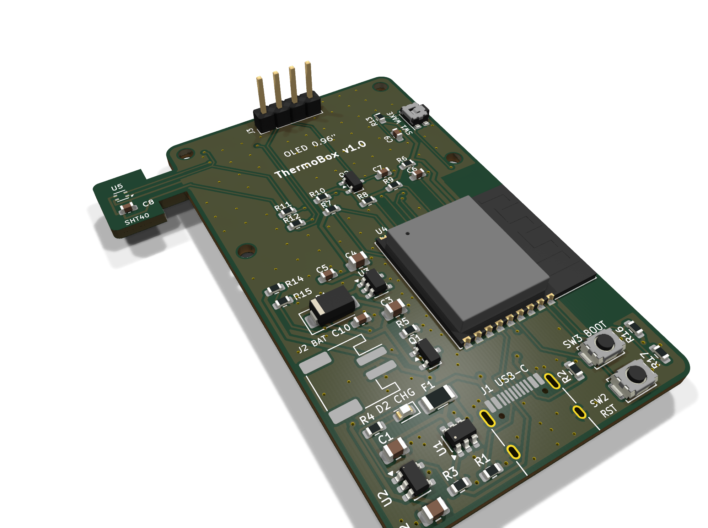

---

## Зміст
1. [Можливості](#можливості)
2. [Схема електрична принципова](#схема-електрична-принципова)
3. [Друкована плата](#друкована-плата)
4. [3D-корпус](#3d-корпус)
5. [Програмний код (Arduino IDE)](#програмний-код-arduino-ide)
6. [Перелік компонентів](#перелік-компонентів)
7. [Структура репозиторію](#структура-репозиторію)

---

## Можливості
- вимірювання температури (±0,2 °C) і вологості датчиком **Sensirion SHT40**;
- OLED-екран 0,96" (128×64, SSD1306, I²C);
- мікроконтролер **ESP32-C3** з вбудованим USB: прошивка з Arduino IDE без окремого перетворювача;
- зарядка Li-Po акумулятора 1000 мА·год через **USB-C** (струм ≈210 мА, мікросхема не перегрівається);
- автоматичне перемикання живлення між USB та акумулятором;
- глибокий сон ≈50 мкА: від одного заряду пристрій працює ≈8–10 місяців;
- бічна кнопка: пробудження, перемикання екранів та три ігри на одну кнопку (Cave Flyer, Jump Runner, Reaction);
- датчик розташований на окремому «язичку» плати, щоб тепло від електроніки не впливало на вимірювання.

## Схема електрична принципова
Схему розроблено в **KiCad 10**. PDF-версія: [Skhema_principialnaya.pdf](2_Skhema/Skhema_principialnaya.pdf).

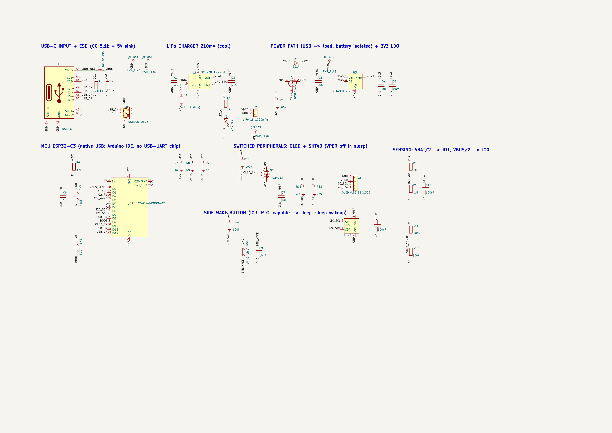

| Вузол | Компоненти | Призначення |
|---|---|---|
| Вхід USB-C | J1, R1, R2 (5,1 кОм), F1 (запобіжник 500 мА), U1 USBLC6-2SC6 | живлення 5 В та USB-дані, захист від статики й КЗ |
| Зарядка | U2 MCP73831, R3 4,7 кОм, D2 (світлодіод) | заряджання Li-Po, індикація зарядки |
| Power path | Q1 AO3401A, D1 SS14 | живлення від USB, коли кабель підключено |
| Стабілізатор 3,3 В | U3 ME6211C33 | живлення мікроконтролера |
| Мікроконтролер | U4 ESP32-C3-WROOM-02, SW2 RESET, SW3 BOOT | керування, USB, Wi-Fi/BLE |
| Периферія | Q2 (ключ), J3 OLED, U5 SHT40 | у режимі сну повністю знеструмлюється |
| Вимірювання | R14/R15, R16/R17 | напруга акумулятора та наявність USB |
| Кнопка | SW1 (бічна), R13, C9 | пробудження та ігри |

## Друкована плата
Двошарова плата 38 × 64 мм (+ язичок датчика), товщина 1,6 мм; усі компоненти на одному боці.

| Гола плата (як із заводу) — верх | Гола плата — низ |
|---|---|
| 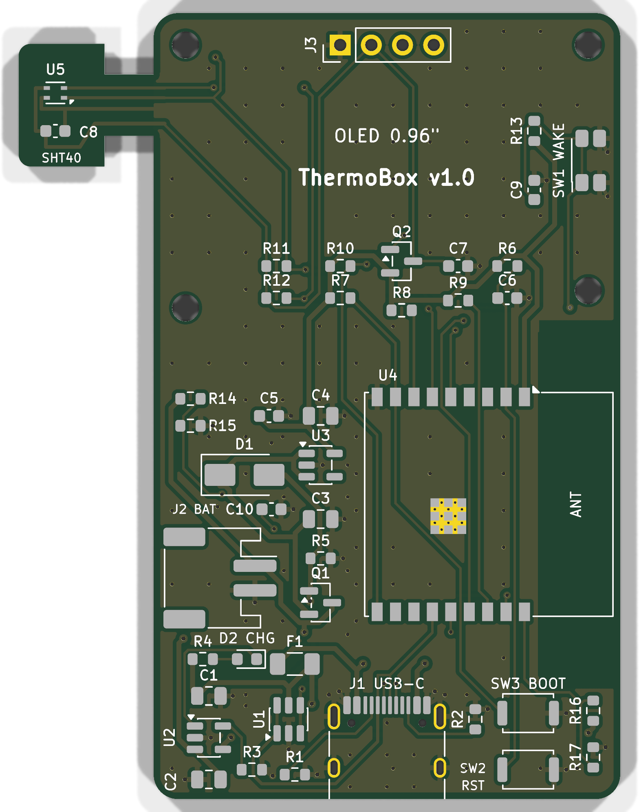 | 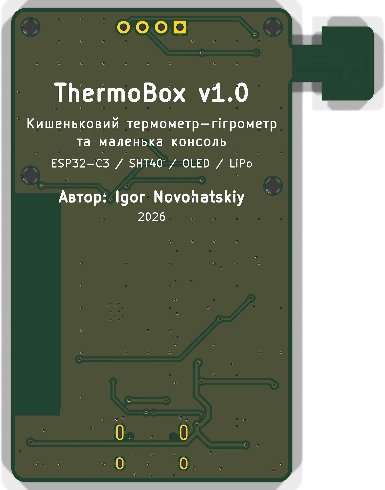 |

| Зібрана плата — верх | Зібрана плата — низ |
|---|---|
| 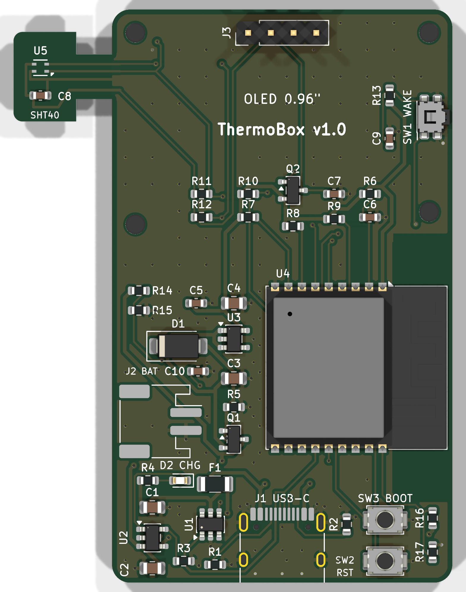 | 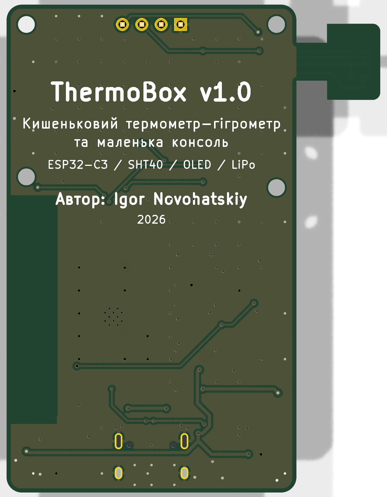 |

Файли для замовлення на заводі (JLCPCB / PCBWay): [ThermoBox_Gerber.zip](3_Plata_fabrichna/ThermoBox_Gerber.zip).

## 3D-корпус
Корпус розроблено у **Fusion 360**. Він складається з основи та кришки, які друкуються на 3D-принтері.

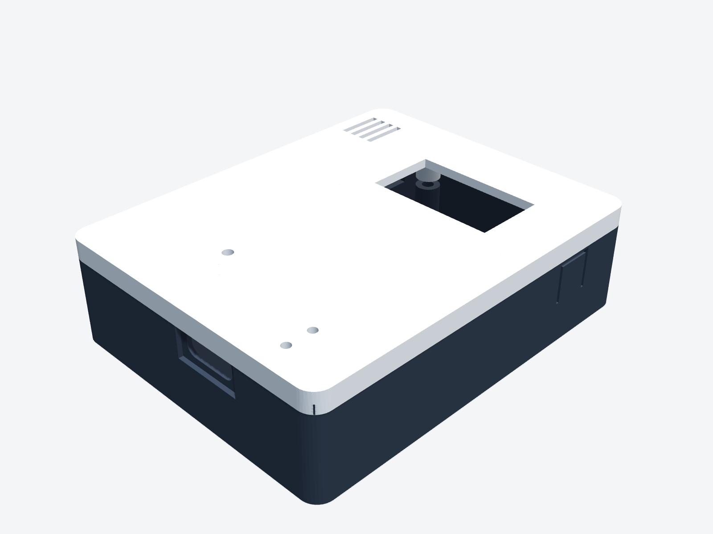

| Розібраний корпус | Основа (вигляд всередину) |
|---|---|
| 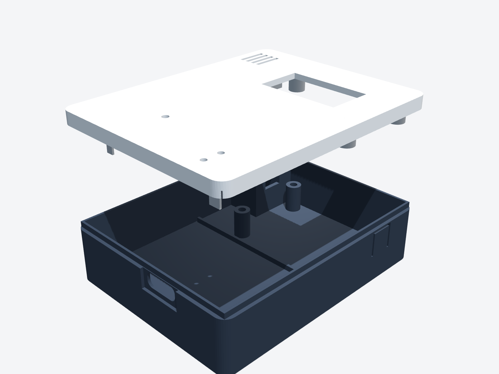 | 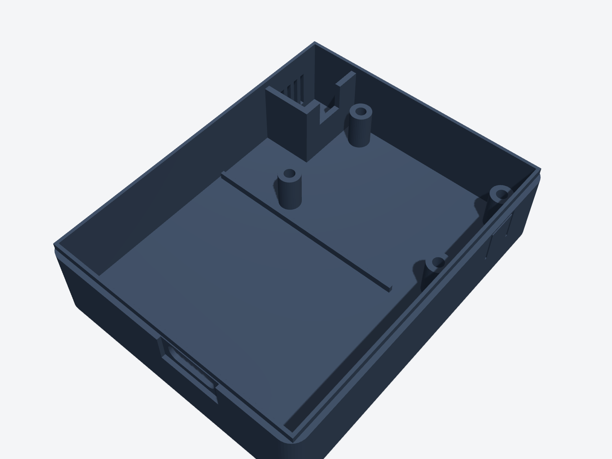 |

| Кришка | Вигляд ззаду |
|---|---|
| 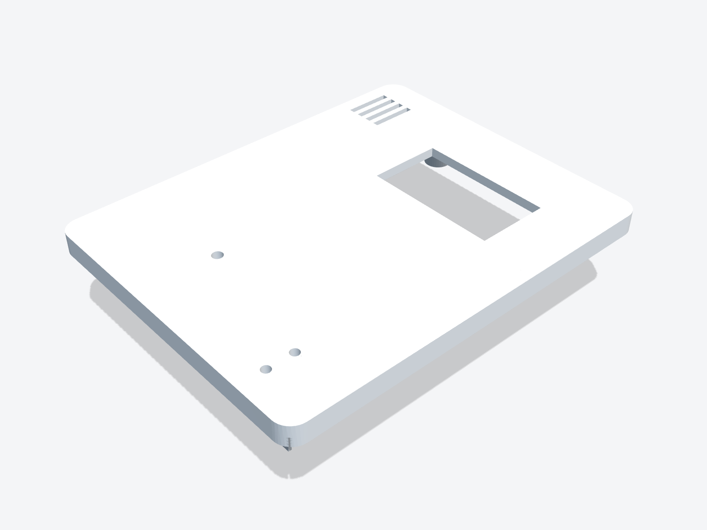 | 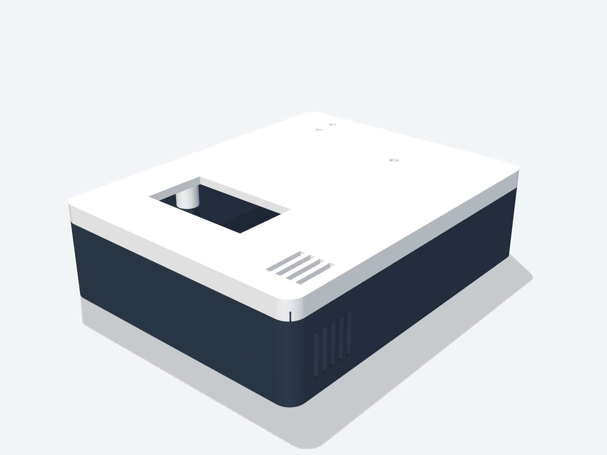 |

- основа: [ThermoBox_Base.stl](1_Korpus_3D/ThermoBox_Base.stl)
- кришка: [ThermoBox_Lid.stl](1_Korpus_3D/ThermoBox_Lid.stl)
- проєкт Fusion 360: [ThermoBox_case.f3d](1_Korpus_3D/ThermoBox_case.f3d)
- збірка (STEP): [ThermoBox_case_assembly.step](1_Korpus_3D/ThermoBox_case_assembly.step)

> Якщо натиснути на файл `.stl`, GitHub відкриє інтерактивний 3D-перегляд: модель можна обертати мишею.

## Програмний код (Arduino IDE)
Код: [ThermoBox.ino](4_Arduino_kod/ThermoBox/ThermoBox.ino)

1. Arduino IDE → *File → Preferences → Additional boards manager URLs*:
   `https://espressif.github.io/arduino-esp32/package_esp32_index.json`
2. *Boards Manager* → встановіть **esp32 by Espressif Systems** (3.x).
3. *Library Manager* → встановіть **U8g2**.
4. *Tools*: Board **ESP32C3 Dev Module**, USB CDC On Boot **Enabled**.
5. Підключіть пристрій кабелем USB-C → **Upload**.

**Керування:**
| Дія | Результат |
|---|---|
| натискання під час сну | пробудження, показ температури |
| коротке натискання | наступний екран (температура / статистика) |
| довге натискання (0,7 с) | меню ігор |
| 10 с без натискань | глибокий сон |

## Перелік компонентів
Повний перелік компонентів: [Spisok_komponentov_BOM.csv](3_Plata_fabrichna/Spisok_komponentov_BOM.csv).
Основні компоненти: ESP32-C3-WROOM-02, SHT40, OLED 0,96" SSD1306, MCP73831, ME6211C33, USBLC6-2SC6, роз'єм USB-C, Li-Po 603450 1000 мА·год.

## Структура репозиторію
```
1_Korpus_3D/        3D-корпус (STL, STEP, Fusion 360) і розміри
2_Skhema/           схема (PNG, PDF) та проєкт KiCad
3_Plata_fabrichna/  зображення плати, Gerber, BOM
4_Arduino_kod/      код для Arduino IDE
```
